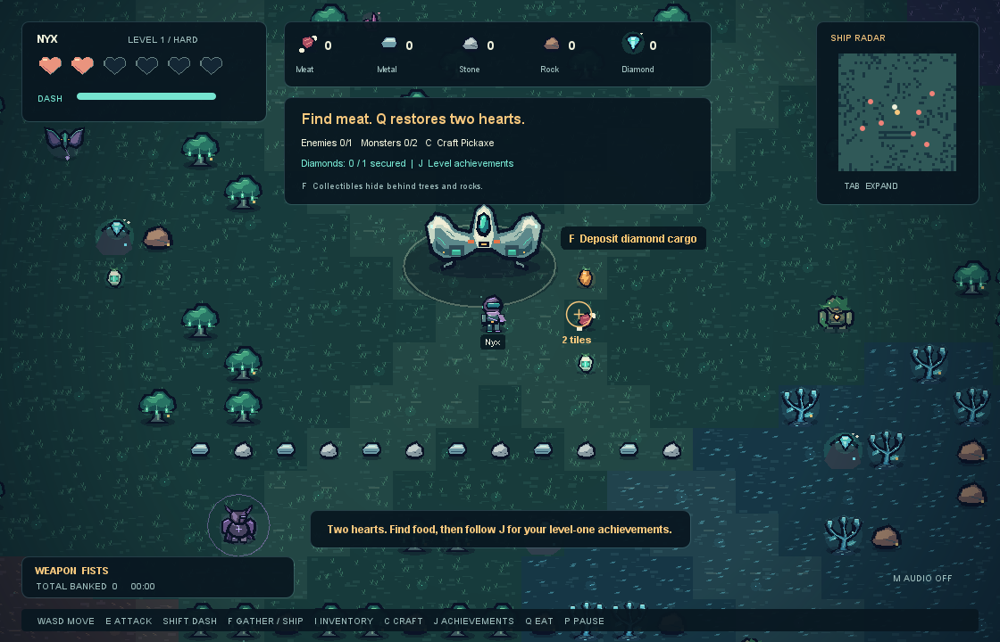

# Aetheria: Starfall Survival

A Java 21 survival adventure with three champions, three difficulty settings and a three-level crafting campaign. Start beside the ship with two filled hearts, fight and gather supplies, build a pickaxe, sword and gun, then bring diamonds home alive.

Carried diamonds are cargo at risk. They count only after you return to the ship and deposit them. Death loses loose resources, while banked diamonds, achievements and crafted equipment remain. At every completed level you choose whether to stay and explore or advance.

The playable application uses only the Java standard library. Gameplay art is original procedural Java2D; one included AI-generated illustration provides the title backdrop. Sounds are synthesized in Java. No third-party engine, database, service, Python or JavaScript runtime is needed to play.



## Quick test 

1. Have **Java 21** installed on a desktop computer (Windows, macOS or Linux with a graphical desktop). Check it with `java -version`.
2. [Download the ready-to-run game](https://github.com/NastyPotion/Aetheria-Starfall-Survival/releases/latest/download/AetheriaCrashLandings.jar).
3. Open a terminal in the download folder and run:

```text
java -jar AetheriaCrashLandings.jar
```

Select **START GAME**. Move with **WASD**, attack with **E**, interact with **F**, and open achievements with **J**. Press **H** for the in-game guide. The game opens in its own desktop window; GitHub does not run the Java application in the browser.

[Download the complete submission](https://github.com/NastyPotion/Aetheria-Starfall-Survival/releases/latest/download/AetheriaCrashLandings-submission.zip) for the source, Eclipse project, tests, runnable JAR, project report, user guide and oral exam study guide. [View all release downloads](https://github.com/NastyPotion/Aetheria-Starfall-Survival/releases/latest).

For source review, use **Code > Download ZIP** on this repository or clone it:

```text
git clone https://github.com/NastyPotion/Aetheria-Starfall-Survival.git
cd Aetheria-Starfall-Survival
```

## Build and run

You need a Java **21 JDK** and a desktop display large enough for the 1120 x 720 game view. From this folder in PowerShell:

```powershell
.\run.ps1
```

The script builds first. Select a JDK explicitly when needed:

```powershell
.\run.ps1 -JavaHome 'C:\Program Files\Android\Android Studio\jbr'
```

`build.ps1`, `test.ps1` and `package.ps1` accept the same option. They also check `JAVA_HOME`, the local Android Studio JDK and tools on `PATH`. PowerShell invokes the JDK; it is not a gameplay runtime dependency.

```powershell
.\build.ps1
.\test.ps1
.\package.ps1
```

Compilation targets Java 21 with `-Xlint:all -Werror`. Classes/resources go into `build/classes`. Tests use plain Java without an external framework and generate previews under `build`.

Final validation passed **625 checks**:

| Suite | Checks |
| --- | --- |
| Persistence and survival data | 136 |
| Campaign progression and asynchronous saves | 204 |
| Survival combat | 139 |
| Survival UI | 32 |
| Feedback and audio fallback | 114 |

The checks include a real-input unarmed first-level expedition through food, harvesting, crafting, diamond mining and ship banking; later-level recipes and stay/advance/completion; selected-character restoration; main-menu saving and resuming both fresh and progressed campaigns; and recoverable asynchronous save/load errors. Generated screens were inspected. Headless audio checks do not establish actual speaker playback on a desktop device.

## Play the campaign

Select **CHAMPION** and **DIFFICULTY** in the menu, then **START GAME**. Astra, Nyx and Orion all begin with 4 health points and can heal to 12. Nyx moves faster and has more dash energy; each champion has an original sprite and name beneath it. Difficulty changes encounter numbers, speed, health and stamina; recipes and objectives stay the same.

| Level | Enemy kills | Monster kills | Gather this level | Craft: materials consumed | Diamonds banked this level |
| --- | --- | --- | --- | --- | --- |
| 1 | 1 | 2 | 1 meat, 2 metal, 2 stone | Pickaxe: 2 metal + 2 stone | 1 |
| 2 | 2 | 2 | 3 metal, 3 stone | Sword: 3 metal + 3 stone | 4 |
| 3 | 3 | 10 fast monsters | 4 metal, 4 stone, 4 rock | Gun: 4 metal + 4 stone + 4 rock | 10 |

Meat is food and a level-one gathering achievement; the pickaxe recipe does **not** consume it. Stone and rock are separate resources. Search behind trees for food, metal and stone; owning a crafted pickaxe permits mining rough rock and diamond deposits. Crafting requires both completed kill/gather achievements and the actual carried recipe materials.

At the ship, press F to deposit diamonds after preparing/crafting. Once the required diamonds are secured, choose **STAY AND EXPLORE** or pass to the next level. At level three, choose **COMPLETE MISSION & RETURN HOME** to finish, or keep exploring. See the agreed [campaign requirements](docs/SURVIVAL_REQUIREMENTS.md).

## Controls

| Input | Action |
| --- | --- |
| WASD / arrows | Move and face a direction |
| E / Space | Attack with equipped fists, pickaxe, sword or gun |
| Shift | Dash; costs 35 energy |
| F | Search/harvest nearby trees or rocks; deposit at the ship |
| I | Inventory and equipment |
| C | Open crafting; press again or click Craft to attempt the recipe |
| J | Achievements, with tabs for all three levels |
| Q | Eat one carried meat to restore two hearts |
| 1 / 2 / 3 / 4 | Equip owned fists / pickaxe / sword / gun |
| N | Reopen the stay/advance choice when ready at the ship |
| Tab / H | Map / guide |
| M | Mute/unmute |
| P / Escape | Pause or close a panel |
| F5 / F9 | Save / load |
| Enter | Begin/resume; respawn after death; stay after level completion |

The top bar shows carried resources, the upper middle shows next steps, and the ship radar guides the return trip. Losing window focus pauses play and clears held keys. The menu also offers **CONTINUE SAVE**, **SAVE GAME** and **QUIT GAME**.

## Saves and respawning

The single slot is Java's user-home directory followed by `.aetheria/save.properties`, normally `%USERPROFILE%\.aetheria\save.properties` on Windows. Saving replaces the slot. Copy it elsewhere if you want another checkpoint.

Version **3** stores the complete map, champion/equipment, individual enemy identities/stats/stamina, inventory and owned weapons, current-level achievements, current/cumulative secured diamonds, time and score. Loading validates the complete snapshot before replacing a mission and restores into pause. Temporary input, projectiles, attack/dash timers, particles and audio playback are not serialized.

Earlier version 1/2 files belong to the former relay campaign and are explicitly incompatible. Loading one explains the difference and preserves the file; it does not silently discard or reinterpret its progress. Begin a new survival campaign to create a v3 slot.

After death, respawn beside the ship with two hearts. All carried materials, including loose diamonds and food, are lost; achievements, banked diamonds and owned equipment remain. A previous save is an alternative checkpoint.

## Eclipse and packaged delivery

1. Import this folder through **File > Import > General > Existing Projects into Workspace**.
2. Select JavaSE-21 for the JRE System Library.
3. Refresh and clean the project.
4. Run `src/com/game/core/Main.java` as a Java application.

The Eclipse identifier remains `AetheriaCrashLandings`. Another Java IDE can use `src` as the source/resource root and `com.game.core.Main` as the entry point.

Packaging creates compatibility-named outputs:

- `dist/AetheriaCrashLandings.jar`: executable game and included resources.
- `dist/AetheriaCrashLandings-submission.zip`: source, resources, Eclipse configuration, scripts, tests, documents, printable PDFs and the JAR.

```powershell
java -jar .\dist\AetheriaCrashLandings.jar
```

The submission ZIP places the JAR at its root and printable documents under `output/pdf`. Its resource lookup works from another working directory. A Java 21 runtime must be available on the destination machine; none is bundled in the JAR.

## Documentation and course requirements

- [Project report](docs/PROJECT_REPORT.md) and [printable report](output/pdf/Aetheria-Starfall-Project-Report.pdf)
- [Oral exam study guide](docs/ORAL_EXAM_GUIDE.md) and [printable study guide](output/pdf/Aetheria-Starfall-Oral-Exam-Guide.pdf)
- [User guide](docs/USER_GUIDE.md) and [printable guide](output/pdf/Aetheria-Starfall-User-Guide.pdf)
- [Proposal](docs/PROJECT_PROPOSAL.md)
- [Agreed survival quantities](docs/SURVIVAL_REQUIREMENTS.md)
- [Five-minute demonstration](docs/DEMO_CHECKLIST.md)
- [Art provenance and exact title prompt](docs/ART_DIRECTION.md)

The report keeps separate source-backed sections for all eleven assessed OOP concepts. Requirements come from the supplied introduction lecture, slides 8-12, in `oop-syllabus.zip`. Student identities, group arrangement, mandatory proposal acknowledgment and oral examination still require the students' confirmation; the files do not establish them.

## Source organization

| Package | Responsibility |
| --- | --- |
| `core` | Window/input/session, encounter construction, state and feedback events |
| `entities` | One configurable champion, meaningful enemy hierarchy, combat capability and projectiles |
| `survival` | Inventory, immutable level requirements, equipment/difficulty and campaign ledger |
| `world` | Private terrain, biomes, harvesting and interactive ship dock |
| `ui` | Menu, HUD, ship radar, map, inventory, crafting and achievements |
| `art` / `assets` | Original generated visuals and cached included resources |
| `effects` / `audio` | Finite event feedback and bounded background synthesis/playback |
| `persistence` | Immutable v3 snapshots, campaign storage interface and recoverable checked errors |


