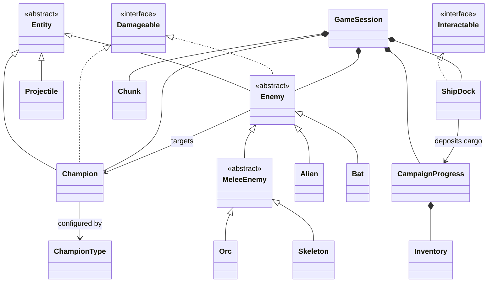
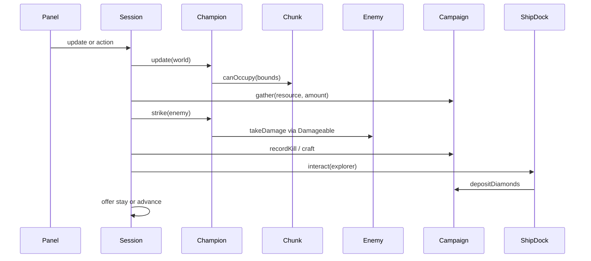

# Aetheria Starfall Survival

## Object Oriented Programming project report

**Platform:** Java 21 desktop application  
**Student names and registration numbers:** complete before submission  
**Companion documents:** USER_GUIDE.md, ORAL_EXAM_GUIDE.md, PROJECT_PROPOSAL.md, SURVIVAL_REQUIREMENTS.md and ART_DIRECTION.md.

## Index

1. Purpose and game rules
2. Objects and their relationships
3. Modularity
4. Hierarchy
5. Composition
6. Reuse
7. Encapsulation
8. Subtyping
9. Information hiding
10. Abstraction
11. Inheritance
12. Polymorphism
13. Exception handling
14. Overloading and coercion
15. Extensibility and customization
16. Application flow and presentation
17. Build and verification
18. Response to the professor feedback
19. Course requirement traceability

## 1. Purpose and game rules

Aetheria is a local survival adventure. An explorer lands beside a ship with two filled hearts, gathers food and materials, fights opponents and crafts equipment. The aim is to secure enough diamonds to return home and help the explorer's people. Carrying a diamond is only the first step: the living explorer must reach the ship and deposit it before it counts toward completion.

This rule connects the objects. The champion moves through terrain, attacks enemies, carries an inventory and interacts with a ship. The campaign ledger decides whether a level is complete. The interface displays the ledger's results rather than deciding the rules itself.

| Level | Defeat | Gather this level | Recipe consumed | Deposit at ship |
| --- | --- | --- | --- | --- |
| 1 | 1 enemy and 2 monsters | 1 meat, 2 metal, 2 stone | Pickaxe using 2 metal and 2 stone | 1 diamond |
| 2 | 2 enemies and 2 monsters | 3 metal and 3 stone | Sword using 3 metal and 3 stone | 4 diamonds |
| 3 | 3 enemies and 10 fast monsters | 4 metal, 4 stone, 4 rock | Gun using 4 of each material | 10 diamonds |

Meat is food and a level-one gathering achievement; the pickaxe recipe does not consume it. Stone and rock are separate resources. Gathering achievements record what was found, whereas inventory records what is still carried. Crafting needs both the achievements and the actual recipe materials.

Astra, Nyx and Orion have different appearances and movement/energy configurations. Every choice starts with four health points, represented by two hearts. Easy, Medium and Hard change hostile numbers, speed, health and stamina. They leave the checklist and recipes unchanged. Level-three enemy health and stamina are double the corresponding level-two values at the same difficulty.

After completing a level, the player chooses to stay and explore or advance. Level three offers staying or completing the return home. Death removes loose cargo, including diamonds, but preserves banked diamonds, achievements and owned equipment. Respawning starts beside the ship with two hearts. Full controls and recovery instructions are in the user guide.

## 2. Objects and their relationships



The design has five central roles: **Champion** is the controlled explorer; **Enemy** is a hostile actor; **Chunk** is the terrain; **CampaignProgress** is the mission ledger and owns an **Inventory**; **ShipDock** is where cargo is secured. **GameSession** coordinates their interactions.

`Entity` is the common parent of Champion, Enemy and Projectile. It stores position, speed and collision dimensions. Champion implements controlled movement/combat and uses ChampionType to configure the three choices. There is one champion implementation because those choices share their behavior. Enemy subclasses express actual behavioral differences. Projectile is another spatial actor with movement and a limited lifetime.

Inheritance means **is a**: Bat is an Enemy, and Enemy is an Entity. Composition means **has a** with ownership: a campaign owns its inventory. The ship references the same campaign that the session uses; that shared link is an association, not a second exclusive ownership relationship. An enemy references its target without owning the champion's lifetime.

Internal enemy identifiers Alien, Bat, Orc and Skeleton correspond to the displayed Mossling, Riftwing, Briar Sentinel and Eclipse Warden. Original sprites and title-art provenance are documented in ART_DIRECTION.md.

| Source group | Responsibility |
| --- | --- |
| core | Main/GameWindow launch; GamePanel handles input/screens; GameSession coordinates the mission; EncounterFactory creates opponents; GameState/GameEvent describe state and feedback |
| entities | Entity, Champion, Enemy and MeleeEnemy hold shared actor behavior; concrete enemies specialize it; Damageable, Projectile, Direction and EnemyType support combat |
| survival | Inventory stores cargo/equipment; CampaignProgress checks achievements; LevelDefinition defines recipes/targets; enums name resources, weapons, champions and difficulty |
| world | Chunk owns terrain/harvesting; TileType/Biome describe the world; Interactable/ShipDock provide device interaction |
| presentation | UI draws menus/panels; SceneRenderer draws ship, attack warnings and atmosphere; art/assets generate and cache images; particles/audio consume feedback |
| persistence | GameSnapshot holds saved values; SaveRepository declares storage; FileSaveRepository reads/writes the slot; SaveGameException reports recoverable failures |

## 3. Modularity

Modularity gives related responsibilities a clear home. Campaign rules belong to survival, terrain to world, actors to entities and file representation to persistence. A recipe changes in LevelDefinition; it needs no second implementation in the interface. GamePanel handles desktop actions while GameSession owns their gameplay meaning.

The UI can ask `campaign.isReady()` without repeating its calculation. In CampaignProgress:

```java
return crafted && achievementsComplete()
        && bankedDiamonds >= getDefinition().diamonds();
```

This single rule serves the completion choice and achievement display. Packages organize source; contracts between the objects keep responsibilities separate during execution.

## 4. Hierarchy

A hierarchy arranges general and specialized types. The actor family starts with Entity, then separates Champion, Enemy and Projectile. Ground melee opponents share MeleeEnemy because their wind-up and strike cycle are common. Actual declaration excerpts are:

```java
public final class Champion extends Entity implements Damageable
public abstract class MeleeEnemy extends Enemy
public final class Bat extends Enemy
```

The class bodies are in the corresponding files under src/com/game/entities. The three champion choices use enum configuration because their differences are data. The enemy hierarchy retains inheritance where behavior changes. Inventory and ShipDock remain separate objects because neither is a kind of combatant.

## 5. Composition

Composition builds a larger object from owned objects with distinct jobs. GameSession owns the champion, world, campaign, ship and encounter/projectile collections. CampaignProgress creates its inventory:

```java
inventory = new Inventory();
```

The campaign uses this object to record items, spend recipes and clear loose cargo after death. Separating inventory from achievements expresses the death rule directly: clearing cargo need not erase the ledger.

A private final reference prevents reassignment; it does not make the referenced object immutable. Inventory remains mutable through its operations. The ship's reference to the existing campaign and an enemy's target reference are shared associations. Composition describes ownership, rather than every field that contains an object.

## 6. Reuse

Reuse avoids copying an existing implementation. All champion choices use the same movement, damage, healing, dash and attack code. Enemy supplies pursuit, stamina, reactions and ordinary rendering. MeleeEnemy supplies one wind-up/strike algorithm to both melee opponent classes.

Riftwing changes one movement rule. Bat.java supplies:

```java
@Override
protected boolean canFly() { return true; }
```

The inherited movement still checks world boundaries; this hook permits flying over solid terrain. The subclass reuses the algorithm and changes one deliberate variation point. LevelDefinition also supplies the same requirements to rule checking and achievement/recipe presentation.

## 7. Encapsulation

Encapsulation combines state with operations that preserve its meaning. Inventory owns private counts and exposes add, remove and spend. Clients cannot directly assign its map entries. Inventory.remove validates a positive amount, then uses:

```java
int previous = count(resource);
if (previous < amount) return false;
items.put(resource, previous - amount);
return true;
```

Unaffordable removal returns false without creating a negative count. The spend method checks the whole recipe before removing ingredients, so failure cannot consume only part of a recipe. CampaignProgress.craft also checks achievements and prevents repeated crafting for that level.

Champion damage/healing operations maintain the health range; healing does not revive a defeated actor. Encapsulation protects valid states, rather than simply replacing every field with an unrestricted setter.

## 8. Subtyping

Subtyping permits a specific object to be used through a compatible general type. Bat can be used as Enemy; both Champion and Enemy support Damageable. The combat contract is:

```java
public interface Damageable {
    void takeDamage(int amount);
    int getCurrentHealth();
    int getMaxHealth();
    boolean isAlive();
}
```

In the active client GameSession.updateEnemies, the loop's Enemy reference is also viewed as Damageable before striking:

```java
Damageable target = enemy;
player.strike(target);
```

Those references designate the same object. The parameter of Champion.strike also has type Damageable. Damage through the parameter changes health subsequently observed through the Enemy reference. No downcast is involved.

These explanatory client declarations make the same relationship explicit:

```java
Enemy enemy = session.getEnemies().get(0);
Entity spatialView = enemy;
Damageable combatView = enemy;
```

The example assumes a session containing an enemy, as a new campaign does. All three variables refer to one object. Their static types determine which operations the compiler permits. The runtime class determines overridden method behavior. This is multityping of one instance, not three separately constructed objects.

## 9. Information hiding

Information hiding conceals representation decisions that clients do not need. The course identifies three decisions: **access modifier**, **class or instance**, and **constant or variable**.

First, declared instance fields are private. Subclasses use narrow inherited operations and read-only observations instead of editing parent coordinates, collision representation or animation fields. Protected methods provide limited behavior hooks. Entity returns a new bounds rectangle, so clients cannot mutate its geometry through a returned alias.

Second, each actor's position, health and stamina belong to its own instance. A shared dash rule belongs to the class. Third, final marks values/references assigned once, while health changes intentionally. Champion contains:

```java
private static final int DASH_COST = 35;
private final int maxEnergy;
private int currentHealth;
```

These are, respectively, a private class constant, private fixed instance value and private mutable instance variable. The energy limit is assigned during construction; final prevents reassignment without making it a compile-time constant. Public static final primitive configuration constants and enum values are supported rules/choices, not exposed mutable actor state. A final collection reference does not freeze its contents: Inventory returns copied maps/sets.

GameSnapshot copies arrays on input/output and copies collections. A record alone is not deeply immutable because its components might reference mutable objects. Defensive copying gives background storage stable values while Swing retains ownership of the live game.

## 10. Abstraction

Abstraction describes operations a client needs while leaving out irrelevant details. Entity declares:

```java
public abstract void update(Chunk chunk, int tileSize);
public abstract void draw(Graphics g, int tileSize);
```

A client can update an actor without knowing its movement algorithm. Champion and Enemy supply implementations for different roles. Damageable abstracts combat independently of either actor branch. Interactable describes device use:

```java
public interface Interactable {
    String getPrompt();
    boolean interact(Champion explorer);
}
```

GameSession uses the ship through this contract. ShipDock checks a living explorer's range and requests a deposit. Its client does not need the range formula or ledger representation. Abstract classes share state/implementation; interfaces describe capabilities. Both have active clients in the game.

## 11. Inheritance

Inheritance derives a specialized class from a superclass and reuses its accessible behavior. The opening of Bat.java is:

```java
public final class Bat extends Enemy {
    public Bat(int tileSize, Champion target) {
        super(EnemyType.BAT, tileSize, target,
                110, 110, 2, 2, "bat");
    }
```

Its remaining methods specialize aggression, flight and animation. The super call initializes the Enemy part of the same object. Constructors are not inherited. Bat inherits health/stamina management, pursuit and rendering, while overriding flight changes the inherited movement algorithm.

Private parent state stays controlled by parent methods; inheritance does not permit direct access to private fields. Champion inherits Entity's spatial behavior without needing three subclasses that only select data. The hierarchy therefore serves actual shared behavior. Inventory and ship relationships use composition/association.

## 12. Polymorphism

Runtime polymorphism lets one general operation execute different implementations according to the actual object's class. GameSession holds a heterogeneous List of Enemy references and calls:

```java
enemy.update(chunk, TILE_SIZE);
```

For melee opponents Java dispatches to MeleeEnemy.update. Other enemies use Enemy.update, whose virtual hooks dispatch to behavior such as Bat.canFly. The session needs no separate movement algorithm for each concrete opponent.

Champion.strike calls takeDamage through Damageable. Champion and Enemy implement that contract with their own damage rules. Subtyping makes reference use legal; dispatch makes an overridden operation vary. They are related mechanisms with different roles.

Storage is another active substitution point: GamePanel accepts SaveRepository, and tests supply controlled implementations for success/failure. The interface is specific to GameSnapshot because the application stores that domain value. List<Enemy> uses Java's type parameters to enforce collection element types at compile time.

## 13. Exception handling

File failures are recoverable. SaveGameException is a checked exception declared by storage operations. FileSaveRepository translates low-level I/O and invalid data into useful failures while preserving the cause. Its load method includes:

```java
catch (IOException | SecurityException exception) {
    throw new SaveGameException(
            "Could not load the campaign: "
            + exception.getMessage(), exception);
}
```

Try-with-resources closes files. Saving writes a temporary file before replacing the slot, using atomic replacement where supported. Loading completes parsing and validation before installing a replacement mission. Failure displays a message and leaves the current campaign available.

IllegalArgumentException reports invalid arguments such as nonpositive resource amounts. An ordinary valid but unaffordable recipe instead returns false. Audio device failure disables cues while gameplay continues. Handling belongs at a boundary that can give a meaningful recovery response.

## 14. Overloading and coercion

**Overloading** uses the same name with different parameter lists. GameSession supplies these constructor signatures:

```java
public GameSession(KeyHandler input)
public GameSession(KeyHandler input,
        ChampionType champion, Difficulty difficulty)
```

The menu's initial session uses the default form; beginning a selected new game uses the second. Both delegate shared initialization. The compiler chooses from argument types/count. This differs from overriding, where a subtype supplies the same instance-method signature and runtime dispatch chooses behavior.

**Coercion and numeric conversion** have a practical use in Inventory.add:

```java
long total = (long) count(resource) + amount;
if (total > Integer.MAX_VALUE)
    throw new IllegalArgumentException("Resource count is too large");
items.put(resource, (int) total);
```

The cast widens count from int to long before addition; numeric promotion also widens amount. After the upper-bound check, the result is narrowed to int for storage. Widening int to long preserves the value, whereas unchecked narrowing could lose data. The example explains why the conversions are needed.

## 15. Extensibility and customization

Useful extension points are small and observable. A flying enemy overrides canFly. A melee subtype specializes damage/timing while reusing the attack algorithm. LevelDefinition centralizes recipes and targets. Another SaveRepository implementation can store GameSnapshot without exposing file keys to the panel.

Extension has limits. A new enemy also requires its type/factory registration, art and save validation. A new champion configuration needs a ChampionType entry and selection display. A fourth level needs progression/validation changes. These costs prevent an exaggerated claim that any feature requires only one new class.

Player customization includes champion/difficulty selection, owned equipment, mute/map/help options and staying or advancing. ChampionType holds identity, sprite prefix, speed and maximum energy; one Champion implementation reads that configuration. Difficulty configures hostile attributes/counts while preserving tasks. The player cannot import arbitrary content or change recipes.

## 16. Application flow and presentation

Main starts Swing on its event thread, GameWindow hosts GamePanel, and input becomes an action on GameSession. Menus, inventory, achievements, map and outcomes are states/overlays of one application, rather than independent pages. Opening an overlay pauses play; losing focus clears held input.



Swing owns live gameplay. A background file worker transfers immutable snapshots and applies completion on Swing. One bounded audio worker owns its sound device. These responsibilities avoid sharing mutable actors across threads.

The slot is normally `%USERPROFILE%\.aetheria\save.properties`. Version 3 saves map, champion/equipment, enemies, inventory and campaign progress. Loaded games begin paused. Input, projectiles and attack/dash timers are temporary. Earlier relay-version saves are explicitly rejected instead of reinterpreted as survival progress.

GamePanel orchestrates terrain and actor drawing. SceneRenderer adds the ship, attack warnings and atmosphere. UI reads the model to draw inventory, hearts/energy, hints, radar, recipes and achievements. Assets caches images; OriginalArt, TerrainArt and PixelArt generate gameplay visuals through Java2D. One included AI-generated PNG supplies the title backdrop. ART_DIRECTION.md records provenance and preserves its generation prompt.

## 17. Build and verification

The program requires Java 21 and a desktop display. Swing/AWT, Java2D, collections, NIO/Properties and JavaSound are standard-library dependencies. There is no external game engine, database interface or web service. Documentation utilities are preparation tools and are not needed to play.

From the project folder, run.ps1 builds/launches, test.ps1 checks behavior, and package.ps1 creates the executable JAR/submission ZIP. Eclipse imports the existing project and runs com.game.core.Main with JavaSE-21. README.md gives complete commands and JDK selection.

Compilation uses `--release 21 -Xlint:all -Werror`. The five test suites passed 625 checks covering persistence validation, real input, full progression, combat, screens and feedback/audio fallback. They verify banked versus loose diamonds, death, recipe spending, explicit advancement and recoverable load failure. Generated previews support visual inspection. Automatic checks cannot establish speaker output on every computer or an assessment result.

The scope is one local campaign and one save slot. Fixed simulation ticks can slow under prolonged event-thread load. Student identities, proposal acknowledgment, group arrangements and the oral examination remain external course requirements.

## 18. Response to the professor feedback

**Inheritance was unclear and lacked code.** Sections 4 and 11 give the actual hierarchy, Bat constructor and behavior override. They distinguish inherited behavior, constructor initialization and private-field access.

**Overloading and coercion snippets were missing.** Section 14 shows active GameSession constructor overloads and Inventory's checked int/long conversion. It distinguishes compile-time selection, overriding and numeric conversion.

**Abstraction was missing.** Section 10 explains Entity, Damageable and Interactable using source operations and actual clients, identifying details omitted by each contract.

**Composition was missing.** Section 5 describes owned session objects and the campaign-owned inventory. Section 2 distinguishes ownership from the shared ship/ledger and enemy/target associations.

**Extensibility was missing.** Section 15 identifies behavior hooks and centralized data, together with registration, artwork and validation changes that a real extension needs.

**Information hiding and its three decisions were inadequately described.** Section 9 explains private instance representation, controlled operations, class versus instance ownership, and constant versus variable values. It distinguishes copied representations from mutable objects behind final references.

**Subtyping/multityping used an inappropriate downcasting example.** Section 8 traces the active Enemy-to-Damageable call and aliases of the same object through Enemy, Entity and Damageable. No downcast is needed.

**Customization was missing.** Sections 1 and 15 describe implemented champion, difficulty, equipment and exploration choices, with the exact rule boundaries they preserve.

## 19. Course requirement traceability

The assessment basis is the supplied OOP introduction PDF, slides 8-12, in oop-syllabus.zip. The information-hiding decisions appear in the supplied OOP inheritance PDF, physical page 16, printed page 17.

| Course requirement | Implementation and explanation |
| --- | --- |
| Modularity | Section 3; package responsibilities and authoritative campaign rule |
| Hierarchy | Section 4; Entity and behavioral actor branches |
| Composition | Section 5; session-owned model and campaign-owned Inventory |
| Reuse | Section 6; shared combat/movement and level data |
| Encapsulation | Section 7; validated inventory/campaign operations |
| Subtyping | Section 8; same enemy through compatible references |
| Information hiding | Section 9; private instance fields, three decisions, copies |
| Abstraction | Section 10; actor/capability contracts with active clients |
| Inheritance | Section 11; Bat construction and reused behavior |
| Polymorphism | Section 12; heterogeneous update and combat dispatch |
| Exception handling | Section 13; checked storage failure and recovery |
| Multiple directly interacting entities | Sections 2/16; explorer, terrain, opponents, projectiles, ship |
| Java within the stated scope | Sections 1/17; standard-library desktop game |
| Motivated report with diagrams/examples | Sections 2-16; concise source-backed explanation |
| Reproducible build and user guide | README, Eclipse files, scripts, resources, USER_GUIDE.md |
| Proposal and course process | PROJECT_PROPOSAL.md; identities, acknowledgment, group arrangement and oral examination require student confirmation |

The oral guide provides a short presentation route and practice questions. It complements this report and the source; the student must understand and explain the implementation during examination.
